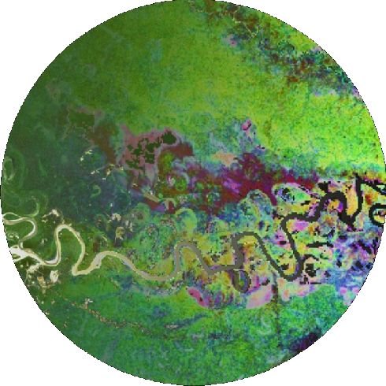

# __biodivMapR__ 

# An R package for α- and β-diversity mapping using remotely-sensed images

[](https://github.com/jbferet/biodivMapR/actions)
[](https://www.r-project.org/Licenses/GPL-3)
[](https://github.com/jbferet/biodivMapR)
[](https://anaconda.org/conda-forge/r-biodivmapr)

# 1 Main principles of `biodivMapR`

## `biodivMapR` aims at being sensor agnostic

`biodivMapR` is an R package aiming at processing remote sensing data provided 
as raster files in order to produce spectral diversity metrics. 

The first versions of the method were initially dedicated to optical 
data processing and the spectral dimension was the key dimension to produce 
features to relate to ecological information. However, since `biodivMapR v2.0`, 
the workflow aims at being **sensor agnostic**: 
**users can provide raster data obtained from optical sensors (multispectral, hyperspectral sensors), LiDAR or radar data.**

Therefore, diversity metrics are no longer spectral.
**Remotely sensed diversity metrics** from a collection of rasters sharing the 
same projection, spatial resolution and extent but different sensors can also be 
provided. 


## `biodivMapR` can work with discrete and continuous representations of data

`biodivMapR` was initially developed to produce $\alpha$ and $\beta$ diversity 
maps, based on the implementation of the method developed by 
[Féret & Asner (2014)](https://doi.org/10.1890/13-1824.1 "Feret&Asner2014"). 

Since the earliest versions of the package, our aim is to provide a tool useful
for the ecologist community, with the capacity to evolve and provide alternative 
ways to handle remote sensing data. 

Therefore, two main representations of data are handled by `biodivMapR`: 

- a **discrete representation** based on clustering techniques, aiming at 
producing 'spectral species': pixels are grouped into clusters, assuming that 
user-defined features allow unsupervised clustering to identify ecologically 
relevant groups corresponding to species, species communities, structurally or 
functionally similar entities. This representation allows to directly compute
diversity metrics usually derived from species inventories (Shannon index, 
Bray-Curtis dissimilarity...).

- a **continuous representation** using directly the feature/trait space, 
aiming at producing Functional diversity metrics **Richness**, **Evenness**, and
**Divergence** as defined in [Villeger et al. (2008)](https://doi.org/10.1890/07-1206.1 "Villeger2008"), 
as well as **Dispersion** and **Rao entropy**. These functional diversity metrics are 
computed with the package [`fundiversity`](https://funecology.github.io/fundiversity/).


`biodivMapR` aims at providing an open source tool where additional diversity 
metrics either based on the discrete or continuous representation of data can be 
easily implemented. 
**If you need specific metrics, want to suggest additional ones, or contribute to their implementation, please feel free to contact the authors of the package**


## `biodivMapR` can produce large scale diversity maps from cloud infrastructures

Efforts have been made in the recent versions to allow the integration of 
`biodivMapR` into cloud infrastructures, in order to produce large scale maps. 

Please contact the authors to exchange and collaborate on the integration 
into cloud infrastructures and the production of large scale maps.


## `biodivMapR` needs (your) validation

As a software developed from researchers and mainly dedicated to researchers, 
`biodivMapR` requires validation to identify its potential and limitations. 

`biodivMapR` uses unsupervised methods. It is not based on modern learning 
techniques. The validation is an on-going process, and contributions are welcome 
to help us to provide recommendations for the application of `biodivMapR` in
different contexts. 


# 2 Install

The package `remotes` first needs to be installed from the CRAN

```
install.packages("remotes")
```

`biodivMapR` should then be ready for installation with the following command line in your R session:

```
remotes::install_github('jbferet/biodivMapR')
```


# 3 Tutorial

A tutorial vignette is available [here](https://jbferet.github.io/biodivMapR/articles/biodivMapR.html).

# 4 Citation

If you use **biodivMapR**, please cite the following references:

Féret, J.-B., de Boissieu, F., 2019. biodivMapR: an R package for α‐ and β‐diversity mapping using remotely‐sensed images. Methods Ecol. Evol. 00:1-7. https://doi.org/10.1111/2041-210X.13310

Féret, J.-B., Asner, G.P., 2014. Mapping tropical forest canopy diversity using high-fidelity imaging spectroscopy. Ecol. Appl. 24, 1289–1296. https://doi.org/10.1890/13-1824.1


# 5 Acknowledgments / Fundings

This research was supported by 
- the Agence Nationale de la Recherche ([ANR](https://anr.fr/en/open-calls-and-preannouncements/), France) through the young researchers project **BioCop** (ANR-17-CE32-0001)
- the Centre National d'Etudes Spatiales ([CNES](https://cnes.fr/)) through the TOSCA projects HyperTropik, HyperBIO, and CODEX.

