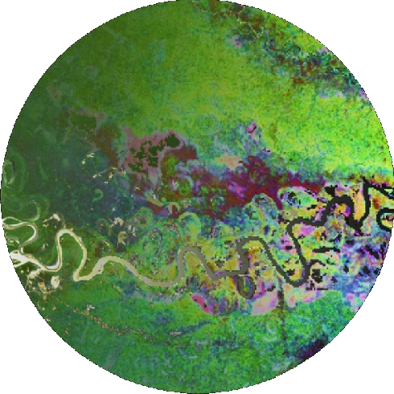

# __biodivMapR__ 

# An R package for α- and β-diversity mapping using remotely-sensed images

[](https://github.com/jbferet/biodivMapR/actions)
[](https://www.r-project.org/Licenses/GPL-3)
[](https://github.com/jbferet/biodivMapR)
[](https://anaconda.org/conda-forge/r-biodivmapr)

# 1 Main functionalities of `biodivMapR`

## Diversity mapping from remote sensing imagery

`biodivMapR` was initially developed to produce spectral diversity metrics from 
remote sensing data provided as raster files.
Our aim is to provide a tool useful for the ecologist community, accessible even 
without strong background in remote sensing. 


## `biodivMapR` is sensor agnostic

The first versions of the method were initially dedicated to optical data 
processing and the spectral dimension was the key dimension to produce 
features which were then related to ecological information. 
Since `biodivMapR v2.0`, the workflow is **sensor agnostic**: 
**users can provide raster data obtained from optical sensors (multispectral, hyperspectral sensors), LiDAR or radar data.**

Diversity metrics are therefore no longer spectral.
**Remotely sensed diversity metrics** from a collection of rasters sharing the 
same projection, spatial resolution and extent but different sensors can also be 
provided.


## `biodivMapR` can work with discrete and continuous representations of data

`biodivMapR` was initially developed to produce $\alpha$ and $\beta$ diversity 
maps, based on the implementation of the method developed by 
[Féret & Asner (2014)](https://doi.org/10.1890/13-1824.1 "Feret&Asner2014"). 


`biodivMapR` handles two main representations of remote sensing data : 

- a **discrete representation** based on clustering techniques, aiming at 
producing 'spectral species': pixels are grouped into clusters, assuming that 
user-defined features allow unsupervised clustering to identify ecologically 
relevant groups corresponding to species, species communities, structurally or 
functionally similar entities. This representation allows to directly compute
$\alpha$ and $\beta$ diversity metrics usually derived from species inventories 
(Shannon index, Bray-Curtis dissimilarity...).

- a **continuous representation** using directly the feature/trait space, 
aiming at producing Functional diversity metrics **Richness**, **Evenness**, and
**Divergence** as defined in [Villeger et al. (2008)](https://doi.org/10.1890/07-1206.1 "Villeger2008"), 
as well as **Dispersion** and **Rao entropy**. These functional diversity metrics 
are computed with the package [`fundiversity`](https://funecology.github.io/fundiversity/).

`biodivMapR` aims at providing an open source tool where additional diversity 
metrics either based on the discrete or continuous representation of data can be 
easily implemented. 
**If you need specific metrics, want to suggest additional ones, or contribute to their implementation, please contact the authors of the package**


## `biodivMapR` can produce large scale diversity maps from cloud infrastructures

Efforts have been made in the recent versions to allow the integration of 
`biodivMapR` into cloud infrastructures, in order to produce large scale maps. 

Please contact the authors to exchange and collaborate on the integration 
into cloud infrastructures and the production of large scale maps.


## `biodivMapR` needs (your) validation and expertise

We want to provide tools performing advanced remote sensing data processing 
to users with little to no initial expertise in this domain, but with expertise 
in ecology. 

`biodivMapR` includes a set of functions to easily perform validation and 
compare geolocated ground observations with diversity metrics produced from 
remotely sensed features. 


**We do not guarantee the ecological relevance of the products obtained with our software**, 
and we strongly value ecological expertise, field observations, in situ 
measurements and long term inventories. 
These are key contributions to the validation of `biodivMapR`, in order to 
identify its potential and limitations.

`biodivMapR` is maintained by scientists. 
Please submit an [issue](https://github.com/jbferet/biodivMapR/issues) to report 
bugs, and if possible provide a full description of the error and a scrpit 
allowing reproducing the bug on a small dataset.
Contributions and suggestions for additional features are welcome.


# 2 Install

The package `remotes` first needs to be installed from the CRAN

```
install.packages("remotes")
```

`biodivMapR` should then be ready for installation with the following command line in your R session:

```
remotes::install_github('jbferet/biodivMapR')
```


# 3 Tutorial

A tutorial vignette is available [here](https://jbferet.github.io/biodivMapR/articles/biodivMapR.html).

# 4 Citation

If you use **biodivMapR**, please cite the following references:

Féret, J.-B., de Boissieu, F., 2019. biodivMapR: an R package for α‐ and β‐diversity mapping using remotely‐sensed images. Methods Ecol. Evol. 00:1-7. https://doi.org/10.1111/2041-210X.13310

Féret, J.-B., Asner, G.P., 2014. Mapping tropical forest canopy diversity using high-fidelity imaging spectroscopy. Ecol. Appl. 24, 1289–1296. https://doi.org/10.1890/13-1824.1


# 5 Acknowledgments / Fundings

This research was supported by 
- the Agence Nationale de la Recherche ([ANR](https://anr.fr/en/open-calls-and-preannouncements/), France) through the young researchers project **BioCop** (ANR-17-CE32-0001)
- the Centre National d'Etudes Spatiales ([CNES](https://cnes.fr/)) through the TOSCA projects HyperTropik, HyperBIO, and CODEX.

